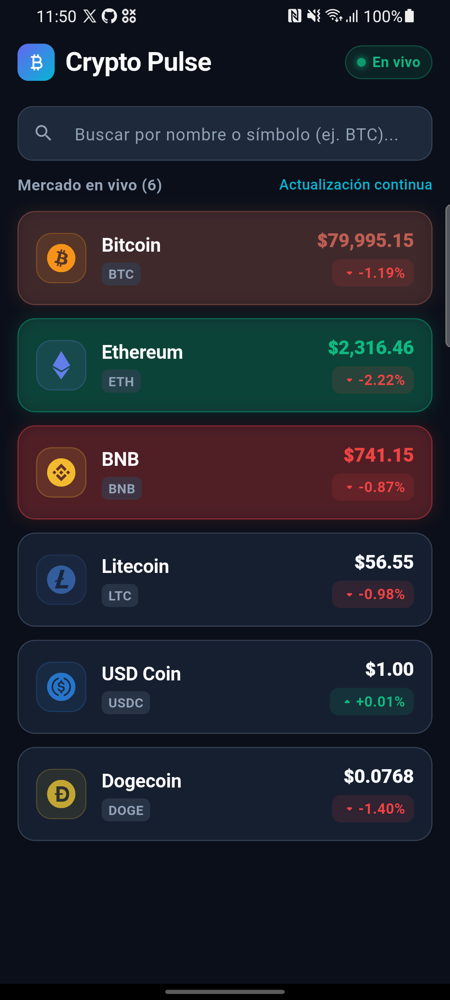

# 🚀 Crypto Pulse - Real-time Crypto Tracker

<div align="center">


-purple)


**Monitor de criptomonedas en tiempo real con WebSockets de Binance, Clean Architecture y Material 3.**

</div>

---

## 📸 Capturas

<div align="center">
  
</div>

---

## ✨ Características

- ⚡ **Precios en Vivo:** Conexión continua a WebSockets de Binance (BTC, ETH, BNB, DOGE, LTC, USDC).
- 🟢🔴 **Micro-animaciones:** Destello dinámico verde/rojo en las tarjetas al detectar variaciones de precio.
- 📡 **Estado de Conexión:** Indicador animado del WebSocket con reconexión automática y manual.
- 🔍 **Búsqueda Instantánea:** Filtrado en tiempo real por nombre o símbolo.
- 🧱 **Clean Architecture:** Separación por capas (`core`, `domain`, `infrastructure`, `presentation`).
- 🛡️ **Manejo Funcional de Errores:** Control de fallos con `Either<Failure, T>` (`fpdart`) sin excepciones no controladas.
- 🔒 **Dart 3 Nativo:** Estados con `sealed class` y pattern matching exhaustivo (sin `freezed` ni code-gen).
- 🎨 **UI Moderna:** Placeholders shimmer de carga y diseño para trading con soporte Dark/Light Mode.

---

## 🛠️ Stack Tecnológico

| Herramienta | Uso |
| :--- | :--- |
| **Flutter & Dart** | Framework multiplataforma y lenguaje base. |
| **Provider** | Inyección de dependencias y gestión de estado reactiva. |
| **fpdart** | Programación funcional y manejo tipado de errores (`Either`). |
| **web_socket_channel** | Streaming en vivo de datos de mercado con Binance. |
| **http** | Consumo de la API REST de Binance (snapshot 24hr). |
| **mocktail** | Mocks y suite de pruebas automatizadas. |

---

## 📂 Estructura del Proyecto

```
lib/
├── core/            # Constantes, temas, utilidades y jerarquía de Failures
├── domain/          # Entidades (Crypto, WsStatus), contratos de repositorios y casos de uso
├── infrastructure/  # DataSources (REST y WebSockets de Binance), DTOs y repositorios
└── presentation/    # Controladores (HomeNotifier, HomeState), vistas y widgets
```

---

## 🚀 Inicio Rápido

1. **Clonar el repositorio:**
   ```bash
   git clone https://github.com/albinrk10/blockchain_app.git
   cd blockchain_app
   ```

2. **Instalar dependencias:**
   ```bash
   flutter pub get
   ```

3. **Ejecutar la aplicación:**
   ```bash
   flutter run
   ```

---

## 🧪 Pruebas Automatizadas

El proyecto incluye 23 pruebas que cubren formateadores, DTOs, fuentes de datos, casos de uso, notifiers y widgets:

```bash
flutter test
```

---

## 📄 Licencia

Este proyecto está bajo la Licencia [MIT](LICENSE).

